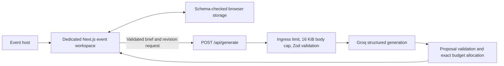

# Mehfiloom

**Make room for your kind of gathering.**

[Live application](https://mehfiloom.vercel.app) · [Submission guide](docs/SUBMISSION.md) · [Design research](frontend/DESIGN.md) · [Security](SECURITY.md)

A GenAI planning assistant for **weddings, birthdays and community events**. Turn an event brief into a personal planning draft with an exact budget allocation, timeline, vendor questions and ideas. Edit practical details in the organizer, then refine the plan with its dedicated assistant.

Each event has a distinct visual identity and separate inspiration, organizer and assistant routes. A wedding draft never becomes a birthday draft when switching pages.

| Experience | Inspiration  | Organizer             | Assistant           | Theme                                         |
| ---------- | ------------ | --------------------- | ------------------- | --------------------------------------------- |
| Wedding    | `/wedding`   | `/wedding/organize`   | `/wedding/assist`   | Burgundy, parchment and romantic arches       |
| Birthday   | `/birthday`  | `/birthday/organize`  | `/birthday/assist`  | Lilac, citron and playful print typography    |
| Community  | `/community` | `/community/organize` | `/community/assist` | Olive, forest and open editorial compositions |

## Try it locally

Use **Node.js 24.x** (`.nvmrc`) and npm. Run commands from the repository root:

```sh
npm ci
npm run dev
```

Open [localhost:3000](http://localhost:3000). Organizers, checklists, vendor notes, starter budgets and text export work without a provider key.

For real AI generation, copy `backend/.env.example` to **`frontend/.env.local`** and set `GROQ_API_KEY` there. Use the same server-side variable in Vercel. Never prefix it with `NEXT_PUBLIC_`, commit it, or paste it into an issue.

```sh
# macOS / Linux
cp backend/.env.example frontend/.env.local
# PowerShell
Copy-Item backend/.env.example frontend/.env.local
```

Missing or invalid provider configuration produces a visible error; the app does not substitute a fake AI response. Keep private guest information out of briefs.

## What it does

- Captures the event name, location, optional date, attendance, currency, budget, style and must-haves.
- Generates tailored plans through **Groq `openai/gpt-oss-120b`**, with event-specific guidance and revision history.
- Validates model output with Zod, then divides the host's budget using exact integer minor-unit arithmetic. Allocations reconcile to the cap.
- Provides an editable starter budget without AI; the interface labels its source clearly.
- Saves independent event drafts, checkmarks, custom tasks and vendor notes in this browser. Exports a readable text copy.
- Carries AI timeline tasks and vendor questions into the matching organizer while retaining host task completion and notes.
- Uses local fonts, responsive images, restrained motion and a lazy desktop Three.js sculpture with an SVG fallback.

A planning allocation is **not a vendor quote or proof of affordability**. Costs, bookings, availability, access arrangements and dietary requirements need confirmation with providers.

## Architecture



| Location                                                            | Responsibility                                                          |
| ------------------------------------------------------------------- | ----------------------------------------------------------------------- |
| `frontend/app/`                                                     | App Router pages, metadata, themes and API route adapter                |
| `frontend/components/`                                              | Shared typed organizer/assistant controls and visual interactions       |
| `frontend/lib/workspace-store.ts`                                   | Live per-event browser persistence and damaged-data recovery            |
| `backend/lib/planner.ts`                                            | Brief/proposal contracts, event templates and exact allocation          |
| `backend/lib/generation-endpoint.ts`                                | HTTP admission, bounded streaming, errors and provider orchestration    |
| `backend/lib/groq.ts`                                               | Provider prompt, strict JSON output, timeout and response validation    |
| `backend/lib/schedule.ts`                                           | Zoned date/time resolution with a bounded formatter cache               |
| `backend/lib/plan-store.ts`, `plan-revisions.ts`, `plan-storage.ts` | Additional tested domain adapters; these are not the live browser store |
| `backend/tests/`, `frontend/tests/`                                 | Domain, HTTP/provider and DOM workflow regression tests                 |

Next.js prerenders the ten public experience pages. The API is server-side; components need client JavaScript for editing and generation. Decorative WebGL loads only when eligible and near the viewport. The initial document remains visible before animation hydration. See [the design notes](frontend/DESIGN.md) for research and motion choices.

## Verification

```sh
npm test                       # 91 backend tests + 21 frontend tests
npm run lint                   # Next.js, React, TypeScript and accessibility rules
npm run typecheck              # Generate route types and strict TypeScript checks
npm run build                  # Optimized Next.js production build
npm run check:secrets           # Reachable Git history; locations only, no values
npm audit --omit=dev            # Blocking production dependency audit
node backend/scripts/report-full-audit.mjs
```

`npm run check` runs tests, lint, types and build together. [GitHub Actions](.github/workflows/ci.yml) repeats these gates using Node 24, read-only permissions and pinned action revisions. [Dependabot](.github/dependabot.yml) checks dependency and action updates weekly.

Frontend tests exercise all three organizers and assistants, independent persistence, damaged/denied storage, exact budget edits, provider errors, revision context and preservation of host work. Nine axe checks cover organizer/assistant and generated budget semantics. Tests mock provider responses and the Next image/link environment; they do not call a paid model. Color contrast and browser layout are not measured by jsdom. These checks do not certify full WCAG conformance or a Lighthouse score.

The production audit is clean at the submission review. The full audit retains one documented **development-only** `braces` advisory affecting Next.js lint tooling. [SECURITY.md](SECURITY.md) explains its scope and the narrowly constrained audit exception. ESLint 10 is supported by the bundled Next.js 16.4.2 guidance; explicit peer overrides bridge three plugins whose published ranges still stop at ESLint 9. `unrs-resolver@1.12.2` is the sole pinned, reviewed dependency install-script approval.

## Deploy on Vercel

Import this repository with **Root Directory left empty**, Node.js **24.x**, and `GROQ_API_KEY` set as a server environment variable. The tracked `vercel.json` runs a locked install, builds from the repository root and serves `frontend/.next`. It removes only Vercel's obsolete `npm_config_cache_dir` variable before npm commands; regular warnings remain visible.

Changing environment variables requires a new deployment. Verify `/api/generate` with a non-sensitive brief after deployment. The API uses a 25-second provider timeout and a 30-second function duration setting. A timeout or quota response preserves the browser draft.

The request limiter is process-local and trusts proxy-overwritten client identity headers. It is **not a shared deployment spending limit**. Configure provider budget caps and deployment abuse controls before scaling beyond a submission demo. No external database, analytics or account service is required.

## Model evaluation

```sh
node --experimental-strip-types backend/scripts/run-model-evaluation.mjs
```

The default command performs an offline fixture preflight with **zero provider calls**. Explicit `--live` mode uses `GROQ_API_KEY` from the process environment or `frontend/.env.local`, makes billed provider requests under a fixture-derived cap and minimum gap, and writes reports to ignored `.local/model-evaluations/`. Review those reports privately before sharing. Shape validation cannot establish semantic correctness; the model can omit constraints or suggest impractical ideas.

## Rights and credits

The application source currently has **no general reuse license**; repository visibility does not grant reuse permission. Bundled fonts retain SIL OFL 1.1 and photographs retain their own terms. See [third-party notices](THIRD_PARTY_NOTICES.md) and [contributing guidance](CONTRIBUTING.md).
